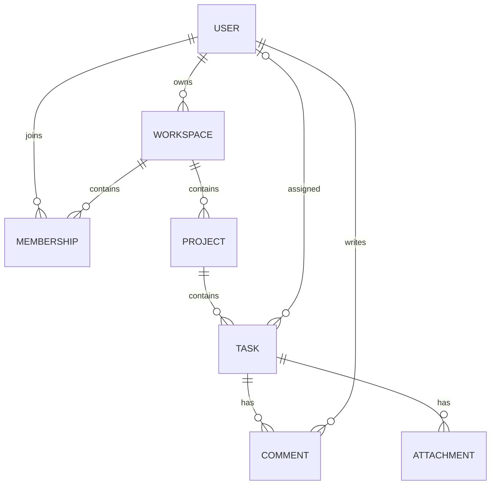

# TeamFlow Backend

NestJS REST API for TeamFlow, a team project management SaaS. The product plan covers workspaces, role-based access, projects, Kanban tasks, and team collaboration. This repository currently provides the database and authentication foundation.

This README follows the TeamFlow architecture and feature plan in `../details.txt`, with implementation status checked against the backend source.

## Implementation status

| Capability | Status |
| --- | --- |
| PostgreSQL connection and TypeORM user migration | Implemented |
| Registration with bcrypt password hashing | Implemented |
| Login with JWT access and refresh tokens | Implemented |
| Refresh endpoint | Implemented |
| JWT bearer-token guard | Implemented, available for route protection |
| DTO validation, Swagger, response interceptor, request logger | Implemented |
| User profile APIs | Planned |
| Logout, session revocation, refresh-token rotation, password reset | Planned |
| Workspaces, memberships, invitations, workspace RBAC | Planned |
| Projects, tasks, Kanban ordering and assignment | Planned |
| Comments, attachments, activity logs, notifications | Planned |
| Real-time collaboration and analytics | Planned |

## Technology

- NestJS 12 and TypeScript with ES modules
- PostgreSQL and TypeORM
- JWT authentication and bcrypt password hashing
- class-validator and class-transformer for request validation
- Swagger for API documentation
- Vitest and Supertest for testing
- NestJS Observe instrumentation

The planned frontend uses Next.js, TypeScript, Tailwind CSS, shadcn/ui, and TanStack Query. Socket.IO, Redis/BullMQ, and S3-compatible storage are future additions.

## Local setup

Use Node.js 20 or later, npm, and a running PostgreSQL server. Run the following commands from `project-shah-backend`.

```sh
npm ci
```

Create a `.env` file in this directory using your local database credentials.

```dotenv
NODE_ENV=development
PORT=4000

DB_HOST=localhost
DB_PORT=5432
DB_USERNAME=postgres
DB_PASSWORD=your_database_password
DB_DATABASE=teamflow_db

JWT_ACCESS_SECRET=replace_with_a_random_access_secret
JWT_REFRESH_SECRET=replace_with_a_different_random_refresh_secret
```

Generate each JWT secret separately with this command and paste the output into `.env`.

```sh
node -e "console.log(require('crypto').randomBytes(48).toString('hex'))"
```

The current authentication implementation reads `JWT_ACCESS_SECRET` and `JWT_REFRESH_SECRET`. Restart the application after changing environment variables. Keep real credentials in the ignored `.env` file.

Create the database using a PostgreSQL client connected as a user with database creation privileges.

```sql
CREATE DATABASE teamflow_db;
```

Apply the migrations before making registration or login requests. Automatic schema synchronization is disabled.

```sh
npm run migration:run -- -d src/database/data-source.ts
npm run start:dev
```

The default API base URL is `http://localhost:4000/api/v1`. Swagger is available at `http://localhost:4000/api/docs` when `NODE_ENV` differs from `production`.

## Current API

All routes below include the global `/api/v1` prefix.

| Method | Route | Purpose |
| --- | --- | --- |
| GET | `/api/v1/health` | Service status |
| POST | `/api/v1/auth/register` | Create a user |
| POST | `/api/v1/auth/login` | Validate credentials and issue tokens |
| POST | `/api/v1/auth/refresh` | Issue a new token pair using a refresh token |

The current POST handlers use NestJS's default HTTP 201 response status.

### Register

Send JSON to `POST /api/v1/auth/register`.

```json
{
  "name": "John Doe",
  "email": "john@example.com",
  "password": "StrongPassword123!"
}
```

Names must contain 3–120 characters, emails must be valid, and registration passwords must contain at least 8 characters. Emails are trimmed and converted to lowercase. Passwords are hashed with bcrypt using 12 salt rounds. Registration returns safe user details.

### Login

Send JSON to `POST /api/v1/auth/login`.

```json
{
  "email": "john@example.com",
  "password": "StrongPassword123!"
}
```

A successful response has this structure. Token values and user details below are illustrative.

```json
{
  "success": true,
  "data": {
    "accessToken": "<access-token>",
    "refreshToken": "<refresh-token>",
    "tokenType": "Bearer",
    "expiresIn": 900,
    "user": {
      "id": "<user-uuid>",
      "name": "John Doe",
      "email": "john@example.com"
    }
  }
}
```

Access tokens expire after 15 minutes. Refresh tokens expire after 7 days. Both carry the user's ID in `sub` and their email. The issuer is `teamflow-api`, with audiences `teamflow-client` for access tokens and `teamflow-refresh` for refresh tokens.

### Refresh

Send JSON to `POST /api/v1/auth/refresh`.

```json
{
  "refreshToken": "<refresh-token>"
}
```

The response contains a new access token, refresh token, token type, and access-token lifetime within the `data` envelope. Existing refresh tokens remain valid until expiration because session storage and revocation are planned work.

The JWT guard reads the `Authorization: Bearer <access-token>` header and attaches the verified payload to `request.user`. Apply `@UseGuards(JwtAuthGuard)` when adding protected endpoints. The current authentication endpoints are public.

### Validation and responses

Successful controller responses use `{ "success": true, "data": ... }`. Exceptions use NestJS's standard error response format. DTO validation rejects undeclared fields and invalid input with HTTP 400. Duplicate registration returns HTTP 409, and invalid login or refresh credentials return HTTP 401.

## Backend structure

```text
src/
  main.ts                         Bootstrap, validation, Swagger, responses
  app.module.ts                   Configuration, database, modules, logging
  app.controller.ts               Service status
  common/
    request-logger.middleware.ts  Request timestamp, method, and URL logging
    response.interceptor.ts       Successful response envelope
  database/
    data-source.ts                TypeORM CLI configuration
    migrations/                   Versioned database changes
  modules/
    auth/                         Registration, login, refresh, JWT guard, DTOs
    users/                        User entity and repository service
```

The `users` table stores a UUID, name, unique email, password hash, and creation/update timestamps. The password hash is excluded from normal entity selection and explicitly selected for credential verification.

## Database migrations

Run migration commands from this directory so the CLI can load `.env` and source migrations.

```sh
# Show migration status
npm run migration:show -- -d src/database/data-source.ts

# Generate a migration after changing entities
npm run migration:generate -- src/database/migrations/DescribeChange -d src/database/data-source.ts

# Apply pending migrations
npm run migration:run -- -d src/database/data-source.ts

# Undo the latest migration
npm run migration:revert -- -d src/database/data-source.ts
```

Review generated SQL before applying changes. The current CLI configuration loads TypeScript migrations from `src/database/migrations`.

## Development commands

| Command | Purpose |
| --- | --- |
| `npm run start:dev` | Run with file watching |
| `npm start` | Start through the Nest CLI |
| `npm run start:debug` | Start with debugging and file watching |
| `npm run build` | Compile to `dist` |
| `node dist/main.js` | Run the compiled application |
| `npm run lint` | Run Oxlint with type-aware checks |
| `npm test` | Run Vitest tests |
| `npm run test:watch` | Run tests in watch mode |
| `npm run test:cov` | Generate test coverage |
| `npm run test:e2e` | Run Supertest end-to-end tests |

The end-to-end test currently imports `AppModule`, requires database configuration, and still expects the starter `Hello World!` response. Update that expectation as part of the testing milestone. The formatting scripts currently target `apps/**/*`, while this backend's source is in `src`.

NestJS Observe is configured in `app.module.ts` with placeholder application credentials. Replace these with your Observe application credentials when configuring telemetry. CORS currently permits all origins.

## Planned architecture

The target workflow connects the Next.js frontend to the NestJS REST API. Controllers validate input, authentication identifies users, workspace authorization checks membership and role, services enforce business rules, and TypeORM persists data in PostgreSQL.

The following model describes the planned domain. Only `User` is currently implemented.



Planned workspace roles are Owner, Admin, Member, and Viewer. Every workspace resource will require membership and permission checks. Workspace creation and owner membership creation will share a transaction. Task assignees will belong to the same workspace as their task.

### Planned API groups

These routes are design targets from `details.txt` and remain to be implemented. Paths are relative to `/api/v1`.

| Area | Planned routes |
| --- | --- |
| Sessions and profiles | `POST /auth/logout`, `POST /auth/logout-all`, `GET/PATCH /users/me`, `PATCH /users/me/password` |
| Workspaces | `POST/GET /workspaces`, `GET/PATCH/DELETE /workspaces/:id` |
| Memberships | `GET /workspaces/:id/members`, `PATCH/DELETE /workspaces/:id/members/:userId` |
| Invitations | `POST/GET /workspaces/:id/invitations`, `POST /invitations/accept`, invitation revocation |
| Projects | `POST/GET /workspaces/:id/projects`, `GET/PATCH/DELETE /projects/:id` |
| Tasks | `POST/GET /projects/:id/tasks`, `GET/PATCH/DELETE /tasks/:id`, `PATCH /tasks/:id/move`, `PATCH /tasks/:id/assignee` |
| Collaboration | Task comments, attachments, activity history, and notifications |
| Analytics | Project statistics and assigned-task summaries |

### Implementation roadmap

1. Complete the foundation with configuration validation and database-backed integration tests.
2. Finish account management with profile APIs, logout, session revocation, refresh-token rotation, and password reset.
3. Add workspaces, memberships, invitations, and role-based authorization with workspace isolation tests.
4. Add project CRUD with workspace-scoped project keys and access checks.
5. Add tasks, filtering, priorities, assignments, due dates, and persistent Kanban ordering with concurrent update handling.
6. Add comments, attachments, activity logs, and workspace-authorized real-time events.
7. Add dashboard statistics and analytics.
8. Complete security checks, CI, deployment, and a portfolio demo.

The backend test plan includes duplicate registration, invalid credentials, unauthorized access, cross-workspace access, viewer restrictions, invalid task assignments, concurrent task updates, and revoked refresh sessions.

## License

The package is currently marked `UNLICENSED`.
